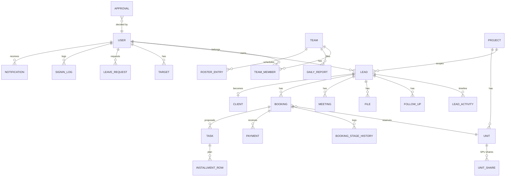

# Data Model (PROPOSED)

PostgreSQL. All tables have `id` (cuid / uuid PK), `created_at`, `updated_at` (timestamptz, UTC). Soft delete (`deleted_at`) applies only where noted. Money is `numeric(14,2)` in PKR, area is `numeric(10,2)` sq ft.

Each entity says where it comes from: **REF** = derived from an observed reference feature, **REF-I** = inferred, **NEW** = proposed. Items marked **⚠ confirm** need a business decision.

---

## 1. Entity relationship overview

---

## 2. Identity and organisation

### users (REF)
| Column | Type | Constraints / notes |
|---|---|---|
| name | text | not null |
| email | citext | unique, not null |
| phone | text | |
| password_hash | text | Argon2id |
| role | enum(`super_admin`,`admin`,`manager`,`agent`,`hr`,`accountant`) | not null ⚠ confirm roles |
| status | enum(`active`,`inactive`) | inactive users cannot sign in |
| designation, department | text | REF (HR "roles, departments") |
| joined_on | date | |
| annual_leave_quota | int | default 30 (REF) |

### sessions (NEW)
`user_id` FK, `token_hash` unique, `expires_at`, `ip`, `user_agent`.

### signin_logs (REF)
`user_id` FK, `event` enum(`sign_in`,`sign_out`), `at`, `ip`, `user_agent`. Index (`user_id`, `at desc`).

### teams (REF)
`name` unique, `manager_id` FK users, `is_active` bool (inactive = excluded from assignment).

### team_members (REF)
`team_id`, `user_id`; PK (`team_id`, `user_id`).

---

## 3. Projects and inventory

### projects (REF)
| Column | Type | Notes |
|---|---|---|
| name | text | unique |
| type | enum(`building`,`farmhouse`,`society`) | REF |
| developer | text | REF-I ("DM Consortium" label) |
| city, address | text | |
| status | enum(`active`,`inactive`) | REF |
| dimension_config | jsonb | per-project unit dimensions (floors, blocks, categories, types, premiums) REF |
| default_rate_per_sqft | numeric | REF-I (app settings) |

### units (REF)
| Column | Type | Notes |
|---|---|---|
| project_id | FK | not null |
| floor | text | e.g. "2nd Floor" |
| block | text | nullable |
| unit_no | text | unique (`project_id`, `unit_no`) |
| sale_model | enum(`whole`,`spu`,`fractional_50`) | REF |
| area_sqft | numeric | > 0 |
| base_price | numeric | ≥ 0 |
| nature | text | e.g. Apartment |
| category, type | text | from project dimension config |
| bedrooms | int | |
| premium | text | REF (dimension) |
| status | enum(`available`,`partially_booked`,`reserved`,`booked`,`sold`) | REF |
| comment | text | |
| listed_on | date | |
Indexes: (`project_id`, `status`), (`project_id`, `floor`).

### unit_shares (REF-I, SPU)
`unit_id` FK, `share_no` int, `area_sqft` (default 50), `status` same enum, unique (`unit_id`, `share_no`). ⚠ confirm the SPU and 50% fractional rules.

---

## 4. Leads

### lead_sources (REF) / cities (NEW) / lost_reasons (REF-I)
Admin-managed lookup tables: `name` unique, `is_active`.

### leads (REF)
| Column | Type | Notes |
|---|---|---|
| code | char(8) | unique, generated |
| project_id | FK | not null |
| owner_id | FK users | nullable until assigned |
| name | text | not null |
| phone_e164 | text | normalised; index (`project_id`, `phone_e164`) |
| country_code, phone_raw | text | as entered |
| email | citext | |
| city_id | FK cities | NEW (replaces free text) |
| gender | text | REF |
| stage | enum(10 stages) | REF |
| stage_changed_at | timestamptz | for "in stage" |
| source_id | FK lead_sources | REF |
| inbound_channel | enum(`manual`,`meta`,`tiktok`,`import`) | REF |
| external_id | text | ad-platform lead ID; unique (`inbound_channel`, `external_id`) |
| raw_payload | jsonb | REF (TikTok payload) |
| budget_range | text / enum | REF ⚠ confirm list |
| desired_size | text | REF |
| priority | enum(`none`,`low`,`medium`,`high`) | REF |
| next_follow_up_at | timestamptz | denormalised for lists |
| first_touch_at | timestamptz | REF |
| last_activity_at | timestamptz | for stale (14 d) |
| is_regenerated | bool | + `regenerated_at` |
| duplicate_of_id | FK leads | REF |
| lost_reason_id | FK | |
| latest_comment | text | denormalised |
Indexes: (`project_id`, `stage`), (`owner_id`, `stage`), (`project_id`, `created_at desc`), (`next_follow_up_at`), trigram index on `name` for search.

### lead_favorites (REF)
PK (`user_id`, `lead_id`).

### lead_activities: timeline (REF)
`lead_id`, `actor_id`, `type` enum(`note`,`stage_change`,`follow_up_scheduled`,`follow_up_done`,`file`,`assignment`,`meeting`,`booking`,`review`,`regenerated`,`system`), `data` jsonb (e.g. from / to stage), `body` text, `at`. Index (`lead_id`, `at desc`).

### follow_ups (REF)
`lead_id`, `assignee_id`, `due_at`, `note`, `status` enum(`pending`,`done`,`cancelled`), `done_at`. Index (`assignee_id`, `status`, `due_at`).

### lead_reviews (REF)
`lead_id`, `reviewer_id`, `body`, `rating` (nullable ⚠).

### files (REF)
`owner_type` (lead / booking / client / expense / income), `owner_id`, `kind` enum(`call_recording`,`document`,`receipt`,`other`), `storage_key`, `mime`, `size_bytes`, `duration_sec` (audio), `uploaded_by`. AI fields for later: `ai_status`, `ai_summary` jsonb.

### rotation_state (REF-I)
`team_id`, `project_id`, `last_user_id`, `updated_at`.

---

## 5. Clients and bookings

### clients (REF)
`lead_id` FK unique (nullable for manual), `name`, `phone_e164`, `email`, `cnic` ⚠ (sensitive; confirm if needed), `address`, `relationship` enum(`prospect`,`investor`,`repeat_investor`) ⚠, `next_follow_up_at`.

### bookings (REF)
| Column | Type | Notes |
|---|---|---|
| project_id, unit_id, unit_share_id | FK | share nullable |
| lead_id, client_id | FK | |
| agent_id | FK users | |
| rate_per_sqft | numeric | REF |
| area_sqft | numeric | snapshot |
| total_sale | numeric | = area × rate − discount |
| token_amount | numeric | REF |
| hold_expires_at | timestamptz | REF (from token) |
| stage | enum(`negotiation`,`token_pending`,`token_received`,`provisional_receipt`,`sales_order`,`booking_form`,`down_payment`,`agreement_pending`,`confirmed`,`cancelled`) | REF |
| payment_instructions | text | REF |
| agreement_sent_at | timestamptz | REF |
| payment_docs_status | enum(`not_submitted`,`submitted`,`verified`) | REF ⚠ |
| paid_total | numeric | derived from payments (cached) |
| cancelled_reason | text | |
Constraint: **only one active booking per unit / share**. Partial unique index on (`unit_id`, `unit_share_id`) where stage ≠ `cancelled`.

### booking_stage_history (REF-I)
`booking_id`, `from_stage`, `to_stage`, `actor_id`, `at`, `note`.

---

## 6. Tasks, meetings, targets

### tasks (REF)
`title`, `type` enum(`general`,`payment_plan`,`proposal`), `status` enum(`open`,`in_progress`,`done`,`cancelled`), `due_at`, `assignee_id`, `created_by`, `lead_id`, `booking_id`, `description`, `proposal` jsonb (cover, project / client headers, unit snapshot, list total, discount %, down payment %, installment count).

### installment_rows (REF)
`task_id`, `seq`, `label`, `description`, `progress` text, `amount`, `due_on` (NEW).

### meetings (REF)
`title`, `starts_at`, `ends_at` (NEW), `organizer_id`, `lead_id`, `location` (NEW), `status` enum(`scheduled`,`completed`,`cancelled`), `notes`.

### targets (REF)
`user_id`, `period` enum(`daily`,`weekly`,`monthly`), `period_start` date, `calls`, `meetings`, `sold_sqft`, `set_by`. Unique (`user_id`, `period`, `period_start`).

### call_logs (REF-I)
Derived from call-recording files (`file_id`, `lead_id`, `agent_id`, `duration_sec`, `at`). It may also take manual call entries ⚠.

---

## 7. Teams operations and HR

### daily_reports (REF)
`team_id`, `report_date`, `submitted_by`; unique (`team_id`, `report_date`).
### daily_report_lines (REF)
`daily_report_id`, `agent_id`, `leads`, `calls`, `meetings`, `tokens`, `bookings`, `remarks`.
### roster_entries (REF)
`team_id`, `user_id`, `date`, `status` enum(`in_office`,`on_site`,`on_leave`,`leads_off`); unique (`user_id`, `date`).
### holidays (REF)
`date`, `name`, `scope` enum(`company`,`regional`), `region`.
### leave_requests (REF)
`user_id`, `type` enum(`annual`,`cpl`), `start_date`, `end_date`, `days` (computed), `reason`, `status` enum(`pending`,`approved`,`rejected`,`cancelled`), `decided_by`, `decided_at`. Check: `end_date >= start_date`.

---

## 8. Cross-cutting

### approvals (REF-I)
`type` enum(`lead_lost`,`leave`,`discount_over_cap`), `subject_type`, `subject_id`, `requested_by`, `status`, `decided_by`, `decided_at`, `comment`.
### notifications (REF)
`user_id`, `type`, `title`, `body`, `link`, `read_at`. Index (`user_id`, `read_at`).
### settings (REF-I)
Key–value (`key` unique, `value` jsonb): agent discount cap (5), ROI per sq ft, default rate, stale days (14), unattended hours (24), rotation enabled, call quality thresholds (30 s / 60 s).
### audit_logs (NEW)
`actor_id`, `action`, `entity`, `entity_id`, `before` jsonb, `after` jsonb, `ip`, `at`. Append-only.

---

## 9. Accounts & Finance (NEW, additional module)

### finance_categories
`kind` enum(`income`,`expense`), `name`; unique (`kind`, `name`).

### payments (booking payments)
| Column | Type | Notes |
|---|---|---|
| booking_id | FK | not null |
| type | enum(`token`,`down_payment`,`installment`,`other`) | |
| amount | numeric | > 0 |
| received_on | date | |
| method | enum(`cash`,`bank_transfer`,`cheque`,`online`) | ⚠ |
| reference | text | cheque / transaction no. |
| receipt_no | text | unique, sequential ⚠ format |
| installment_row_id | FK | nullable |
| reversal_of_id | FK payments | reversals instead of deletes |
| recorded_by | FK users | |

### income_records / expense_records
`category_id`, `amount`, `date`, `method`, `reference`, `project_id` (nullable), `booking_id` (income, nullable), `payee` (expense), `description`, `recorded_by`, `reversal_of_id`. Attachments via `files`.

**Derived (views):** `booking_balances` (total_sale, paid, outstanding, overdue_amount by schedule), `monthly_income_expense`, `collections_by_project`.
