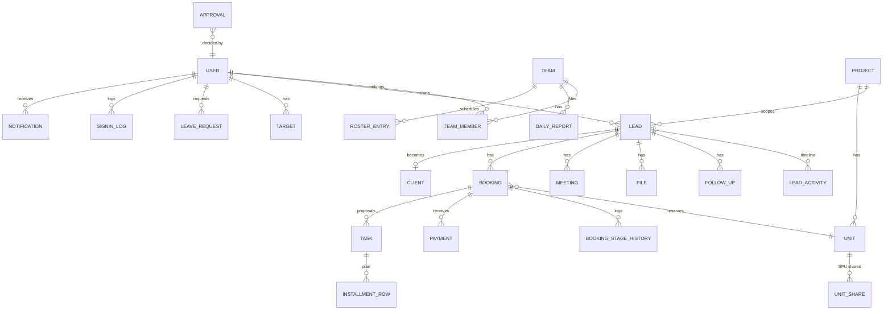

# Data Model (PROPOSED)

PostgreSQL. All tables have `id` (cuid / uuid PK), `created_at`, `updated_at` (timestamptz, UTC). Soft delete (`deleted_at`) applies only where noted. Money is `numeric(14,2)` in PKR, area is `numeric(10,2)` sq ft.

Each entity says where it comes from: **REF** = derived from an observed reference feature, **REF-I** = inferred, **NEW** = proposed. Items marked **⚠ confirm** need a business decision.

> **Updated 16 Nov 2026.** This file began as the proposal. The built schema is `src/server/db/schema.ts` and the migrations in `drizzle/`; where they differ, the code wins. §10 lists every table, column and enum value added by migrations 0034–0050 (14–16 Nov 2026).

---

## 1. Entity relationship overview

---

## 2. Identity and organisation

### users (REF)
| Column | Type | Constraints / notes |
|---|---|---|
| name | text | not null |
| email | citext | unique, not null |
| phone | text | |
| password_hash | text | Argon2id |
| role | enum(`super_admin`,`admin`,`manager`,`agent`,`hr`,`accountant`) | not null. `manager` is no longer given: migration 0034 (13 Nov 2026) made every Manager an Admin. The value stays because Postgres can't drop it |
| status | enum(`active`,`inactive`) | inactive users cannot sign in |
| designation, department | text | REF (HR "roles, departments") |
| joined_on | date | |
| annual_leave_quota | int | default 30 (REF) |

### sessions (NEW)
`user_id` FK, `token_hash` unique, `expires_at`, `ip`, `user_agent`.

### signin_logs (REF)
`user_id` FK, `event` enum(`sign_in`,`sign_out`), `at`, `ip`, `user_agent`. Index (`user_id`, `at desc`).

### teams (REF)
`name` unique, `manager_id` FK users (shown as "Team admin"), `team_lead_id` FK users (nullable, migration 0044: one of the team's agents, appointed by an Admin or Super Admin), `is_active` bool (inactive = excluded from assignment).

### team_members (REF)
`team_id`, `user_id`; PK (`team_id`, `user_id`).

---

## 3. Projects and inventory

### projects (REF)
| Column | Type | Notes |
|---|---|---|
| name | text | unique |
| type | enum(`building`,`farmhouse`,`society`) | REF |
| developer | text | REF-I ("DM Consortium" label) |
| city, address | text | |
| status | enum(`active`,`inactive`) | REF |
| dimension_config | jsonb | per-project unit dimensions (floors, blocks, categories, types, premiums) REF |
| default_rate_per_sqft | numeric | REF-I (app settings) |
| payment_plan | jsonb | Migration 0042: the project's own payment plan (down payment %, installment count, months between installments, possession %, balloon payments). Empty `{}` = the standard plan |
| archived_at | timestamptz | Migration 0046: set when the Super Admin archives the project. Hidden everywhere, history kept, can be restored |

### units (REF)
| Column | Type | Notes |
|---|---|---|
| project_id | FK | not null |
| floor | text | e.g. "2nd Floor" |
| block | text | nullable |
| unit_no | text | unique (`project_id`, `unit_no`) |
| sale_model | enum(`whole`,`spu`,`fractional_50`) | REF |
| area_sqft | numeric | > 0 |
| base_price | numeric | ≥ 0 |
| nature | text | e.g. Apartment |
| category, type | text | from project dimension config |
| bedrooms | int | |
| premium | text | REF (dimension) |
| status | enum(`available`,`partially_booked`,`reserved`,`booked`,`sold`) | REF |
| comment | text | |
| listed_on | date | |
| archived_at | timestamptz | Migration 0046: archived by the Super Admin, same rules as projects |
Indexes: (`project_id`, `status`), (`project_id`, `floor`).

### unit_shares (REF-I, SPU)
`unit_id` FK, `share_no` int, `area_sqft` (default 50), `status` same enum, unique (`unit_id`, `share_no`). ⚠ confirm the SPU and 50% fractional rules.

---

## 4. Leads

### lead_sources (REF) / cities (NEW) / lost_reasons (REF-I)
Admin-managed lookup tables: `name` unique, `is_active`. City names are unique in any letter case (`cities_name_lower_uq`). Cities are deactivated, never deleted.

### leads (REF)
| Column | Type | Notes |
|---|---|---|
| code | char(8) | unique, generated |
| project_id | FK | not null |
| owner_id | FK users | nullable until assigned |
| name | text | not null |
| phone_e164 | text | normalised; index (`project_id`, `phone_e164`) |
| country_code, phone_raw | text | as entered |
| email | citext | |
| city_id | FK cities | NEW (replaces free text) |
| city_other | text | A city typed under "Other" (FR-042); `city_id` is then null. Same column on `clients` |
| gender | text | REF |
| stage | enum(10 stages) | REF |
| stage_changed_at | timestamptz | for "in stage" |
| source_id | FK lead_sources | REF |
| inbound_channel | enum(`manual`,`meta`,`tiktok`,`import`) | REF |
| external_id | text | ad-platform lead ID; unique (`inbound_channel`, `external_id`) |
| raw_payload | jsonb | REF (TikTok payload) |
| budget_range | text / enum | REF ⚠ confirm list |
| desired_size | text | REF |
| priority | enum(`none`,`low`,`medium`,`high`) | REF |
| next_follow_up_at | timestamptz | denormalised for lists |
| first_touch_at | timestamptz | REF |
| last_activity_at | timestamptz | for stale (14 d) |
| is_regenerated | bool | + `regenerated_at` |
| duplicate_of_id | FK leads | REF |
| lost_reason_id | FK | |
| latest_comment | text | denormalised |
| verification | enum(`pending`,`approved`,`rejected`) | Lead verification (13 Nov 2026): an agent's hand-added lead starts `pending`; everything else (and every older lead) is `approved` |
| verification_note | text | The reason given when rejected |
| verified_by_id, verified_at | FK users, timestamptz | Who approved or rejected it, and when |
Indexes: (`project_id`, `stage`), (`owner_id`, `stage`), (`project_id`, `created_at desc`), (`next_follow_up_at`), trigram index on `name` for search.

### lead_favorites (REF)
PK (`user_id`, `lead_id`).

### Sprint tables (Nov 2026)
| Table | Purpose |
|---|---|
| `lead_phones`, `client_phones` | Numbers 2–5 (position 2–5), normalised E.164, unique per record; every number is used for customer matching |
| `lead_assignments` | Every ownership decision: mode (scored, returning_customer, claim, manual, creator, import, rotation — `rotation` added by migration 0035), reason, each candidate's score breakdown, actor, previous owner |
| `lead_import_batches`, `lead_import_rows` | Submitted import files and their validated rows; nothing becomes a lead until a Super Admin approves |
| `backup_runs` | Backup, restore, restore-check and retention runs: status, folder name, size, message. No contents, no credentials |

Assignment weights and thresholds are `app_settings` keys `assignment.*` (defaults in `src/modules/leads/assignment-score.ts`).

### lead_activities: timeline (REF)
`lead_id`, `actor_id`, `type` enum(`note`,`stage_change`,`follow_up_scheduled`,`follow_up_done`,`file`,`assignment`,`meeting`,`booking`,`review`,`regenerated`,`system`), `data` jsonb (e.g. from / to stage), `body` text, `at`. Index (`lead_id`, `at desc`).

### follow_ups (REF)
`lead_id`, `assignee_id`, `due_at`, `note`, `status` enum(`pending`,`done`,`cancelled`), `done_at`. Index (`assignee_id`, `status`, `due_at`).

### lead_reviews (REF)
`lead_id`, `reviewer_id`, `body`, `rating` (nullable ⚠).

### files (REF)
`owner_type` (lead / booking / client / expense / income), `owner_id`, `kind` enum(`call_recording`,`document`,`receipt`,`other`), `storage_key`, `mime`, `size_bytes`, `duration_sec` (audio), `uploaded_by`. AI fields for later: `ai_status`, `ai_summary` jsonb.

As built, a file points to its owner through separate nullable columns: `lead_id`, `finance_entry_id`, `payment_id`, `client_id` and, since migration 0039 (14 Nov 2026), `booking_id` (transfer screenshots an agent attaches to a booking before Accounts posts the payment, kind `receipt`). Deleting hides the file (`deleted_at`, `deleted_by_id`); nothing is erased.

### rotation_state (REF-I)
`team_id`, `project_id`, `last_user_id`, `updated_at`.

---

## 5. Clients and bookings

### clients (REF)
**Since 13 Nov 2026 a client is the person and every lead is one of their inquiries:** each new lead joins the client holding one of its numbers or creates one (owner = the lead's owner); `leads.client_id` is set for every lead (migration 0033 backfilled existing leads, one client per phone number). A client's standing per project is derived from its leads there: booked, lost interest (every lead lost) or interested.

`lead_id` FK unique (nullable for manual), `name`, `phone_e164`, `email`, `cnic` ⚠ (sensitive; confirm if needed), `address`, `relationship` enum(`prospect`,`investor`,`repeat_investor`) ⚠, `next_follow_up_at`.

### bookings (REF)
| Column | Type | Notes |
|---|---|---|
| project_id, unit_id, unit_share_id | FK | share nullable |
| lead_id, client_id | FK | |
| agent_id | FK users | |
| rate_per_sqft | numeric | REF |
| area_sqft | numeric | snapshot |
| total_sale | numeric | = area × rate − discount |
| token_amount | numeric | REF |
| hold_expires_at | timestamptz | REF (from token) |
| stage | enum(`negotiation`,`token_pending`,`token_received`,`provisional_receipt`,`sales_order`,`booking_form`,`down_payment`,`agreement_pending`,`confirmed`,`cancelled`) | Since migration 0036 (14 Nov 2026) only four stages are used: Token (`token_pending`, the default), Partial Down Payment (`down_payment`), Complete Down Payment (`agreement_pending`) and Closed Won (`confirmed`), plus `cancelled`. The other values stay in the enum but are no longer set |
| discount_pct | numeric(5,2) | Migration 0040: discount on the inventory price, default 0. Agents give up to the cap themselves |
| discount_requested_pct | numeric(5,2) | The higher % the agent asked for, waiting for an Admin or Super Admin |
| discount_status | enum(`none`,`pending`,`approved`,`rejected`) | New enum `discount_status`, default `none`. A rejection keeps the booking at the cap |
| discount_decided_by_id, discount_decided_at, discount_note | FK users, timestamptz, text | Who decided the discount, when, and why |
| payment_instructions | text | REF |
| agreement_sent_at | timestamptz | REF |
| payment_docs_status | enum(`not_submitted`,`submitted`,`verified`) | REF ⚠ |
| paid_total | numeric | derived from payments (cached) |
| cancelled_reason | text | |
Constraint: **only one active booking per unit / share**. Partial unique index on (`unit_id`, `unit_share_id`) where stage ≠ `cancelled`.

### booking_stage_history (REF-I)
`booking_id`, `from_stage`, `to_stage`, `actor_id`, `at`, `note`.

---

## 6. Tasks, meetings, targets

### tasks (REF)
`title`, `type` enum(`general`,`payment_plan`,`proposal`), `status` enum(`open`,`in_progress`,`done`,`cancelled`), `due_at`, `assignee_id`, `created_by`, `lead_id`, `booking_id`, `description`, `proposal` jsonb (cover, project / client headers, unit snapshot, list total, discount %, down payment %, installment count).

### installment_rows (REF)
`task_id`, `seq`, `label`, `description`, `progress` text, `amount`, `due_on` (NEW).

### meetings (REF)
`title`, `starts_at`, `ends_at` (NEW), `organizer_id`, `lead_id`, `location` (NEW), `status` enum(`scheduled`,`completed`,`cancelled`), `notes`.

### targets (REF)
`user_id`, `period` enum(`daily`,`weekly`,`monthly`,`custom`), `period_start` date, `period_end` date, `calls`, `meetings`, `sold_sqft`, `set_by`. Unique (`user_id`, `period`, `period_start`).

Migration 0048 (16 Nov 2026) added the `custom` period (any From–To range, e.g. a campaign) and `period_end`. Check `targets_custom_end`: `period_end` is set exactly when the period is `custom`, is on or after `period_start`, and the range is at most 366 days.

### target_custom_goals (NEW, migration 0049)
Goals the CRM can't count, e.g. "Brochures delivered: 50". `target_id` FK targets (cascade), `name` (1–60 characters, unique per target ignoring case), `goal` numeric > 0, `achieved` numeric ≥ 0 (entered by hand, default 0), `sort_order`, `updated_by_id` FK users. Index (`target_id`, `sort_order`).

### call_logs (REF-I)
Derived from call-recording files (`file_id`, `lead_id`, `agent_id`, `duration_sec`, `at`). It may also take manual call entries ⚠.

---

## 7. Teams operations and HR

### daily_reports (REF)
`team_id`, `report_date`, `submitted_by`; unique (`team_id`, `report_date`).
### daily_report_lines (REF)
`daily_report_id`, `agent_id`, `leads`, `calls`, `meetings`, `tokens`, `bookings`, `remarks`.
### roster_entries (REF)
`team_id`, `user_id`, `date`, `status` enum(`in_office`,`on_site`,`on_leave`,`leads_off`); unique (`user_id`, `date`).
### holidays (REF)
`date`, `name`, `scope` enum(`company`,`regional`), `region`.
### leave_requests (REF)
`user_id`, `type` enum(`annual`,`cpl`), `start_date`, `end_date`, `days` (computed), `reason`, `status` enum(`pending`,`approved`,`rejected`,`cancelled`), `decided_by`, `decided_at`. Check: `end_date >= start_date`.

As built: `type` is enum(`annual`,`medical`) ("CPL" means medical leave), `status` is enum(`pending`,`approved`,`rejected`,`withdrawn`,`cancel_requested`,`cancelled`), and each decision is a row in `leave_decisions`. `approval_path` is `senior` or `staff`; `current_step` is 1 or 2.

Migration 0047 (16 Nov 2026), leave recorded for someone:
- `user_id` is now nullable.
- `employee_profile_id` FK employee_profiles (restrict): staff without a CRM login.
- `recorded_by_id` FK users (set null): set when HR or an Admin recorded the leave for the person.
- Check `leave_requests_one_person`: exactly one of `user_id` and `employee_profile_id` is set.
- Index (`employee_profile_id`, `start_date`).

### attendance_records (NEW, migration 0043)
One row per person per business day (Asia/Karachi). `user_id` FK users (cascade), `date`, `check_in_at` (not null), `check_out_at` (on or after check-in), `corrected_by_id` FK users and `correction_note` (≤ 300 characters) when HR corrected the times. Unique (`user_id`, `date`); index (`date`). Present, late, absent, on leave, holiday and weekend are worked out from this row, leave, holidays and office hours; they are not stored.

### employee_profiles (NEW)
HR fields for an employee: `user_id` FK users (unique, nullable for staff without a login), `full_name`, `email` and `status` (staff without a login only), `designation`, `department`, phone (`phone_country_code`, `phone_number`, `phone_e164`), `joining_date`, `updated_by_id`.

### employee_notes (NEW, migration 0050)
Private coaching notes Admins keep on an employee's work profile. `user_id` FK users (cascade), `author_id` FK users (set null), `body` (1–2,000 characters), `created_at`. Index (`user_id`, `created_at`). The person they are about never sees them.

---

## 8. Cross-cutting

### approvals (REF-I)
`type` enum(`lead_lost`,`leave`,`discount_over_cap`), `subject_type`, `subject_id`, `requested_by`, `status`, `decided_by`, `decided_at`, `comment`.
### notifications (REF)
`user_id`, `type`, `title`, `body`, `link`, `read_at`. Index (`user_id`, `read_at`).

`type` is the `notification_type` enum: `lead_assigned`, `lead_regenerated`, `lost_requested`, `lost_rejected`, `follow_up_soon`, `lead_verification_requested`, `lead_verified`, `target_met` (0037), `name_changed` (0038), `discount_requested` and `discount_decided` (0040), `booking_rejected` (0041), `import_requested` and `import_decided` (0045).
### settings (REF-I)
Key–value (`key` unique, `value` jsonb): agent discount cap (5), ROI per sq ft, default rate, stale days (14), unattended hours (24), rotation enabled, call quality thresholds (30 s / 60 s).
### audit_logs (NEW)
`actor_id`, `action`, `entity`, `entity_id`, `before` jsonb, `after` jsonb, `ip`, `at`. Append-only.

---

## 9. Accounts & Finance (NEW, additional module)

### finance_categories
`kind` enum(`income`,`expense`), `name`; unique (`kind`, `name`).

### payments (booking payments)
| Column | Type | Notes |
|---|---|---|
| booking_id | FK | not null |
| type | enum(`token`,`down_payment`,`installment`,`other`) | |
| amount | numeric | > 0 |
| received_on | date | |
| method | enum(`cash`,`bank_transfer`,`cheque`,`online`) | ⚠ |
| reference | text | cheque / transaction no. |
| receipt_no | text | unique, sequential ⚠ format |
| installment_row_id | FK | nullable |
| reversal_of_id | FK payments | reversals instead of deletes |
| recorded_by | FK users | |

### income_records / expense_records
`category_id`, `amount`, `date`, `method`, `reference`, `project_id` (nullable), `booking_id` (income, nullable), `payee` (expense), `description`, `recorded_by`, `reversal_of_id`. Attachments via `files`.

**Derived (views):** `booking_balances` (total_sale, paid, outstanding, overdue_amount by schedule), `monthly_income_expense`, `collections_by_project`.

---

## 10. Schema changes 14–16 Nov 2026 (migrations 0034–0050)

Updated 16 Nov 2026. Every change below is also described in the section for its table.

| Migration | Change |
|---|---|
| 0034 `managers_become_admins` | Data only: every `manager` user became `admin`. The enum value stays but is no longer given |
| 0035 `assignment_rotation` | Enum value `rotation` added to `lead_assignment_mode` |
| 0036 `booking_stages` | `bookings.stage` default is now `token_pending`. Open bookings in retired stages moved to Token. Four stages in use (see §5) |
| 0037 `target_met_notification` | Enum value `target_met` added to `notification_type` |
| 0038 `name_changed_notification` | Enum value `name_changed` added to `notification_type` |
| 0039 `booking_payment_proofs` | `files.booking_id` FK bookings (restrict) |
| 0040 `booking_discount_approval` | New enum `discount_status` (`none`,`pending`,`approved`,`rejected`); `bookings.discount_pct`, `discount_requested_pct`, `discount_status`, `discount_decided_by_id`, `discount_decided_at`, `discount_note`; notification types `discount_requested`, `discount_decided` |
| 0041 `booking_rejected_notification` | Enum value `booking_rejected` added to `notification_type` |
| 0042 `project_payment_plan` | `projects.payment_plan` jsonb, default `{}` |
| 0043 `attendance` | New table `attendance_records` (see §7) |
| 0044 `team_lead` | `teams.team_lead_id` FK users (set null) |
| 0045 `import_notifications` | Enum values `import_requested`, `import_decided` added to `notification_type` |
| 0046 `archive_projects_units` | `projects.archived_at`, `units.archived_at` |
| 0047 `leave_for_records` | `leave_requests.user_id` nullable; `employee_profile_id`, `recorded_by_id`; check `leave_requests_one_person`; index on (`employee_profile_id`, `start_date`) |
| 0048 `custom_target_period` | Enum value `custom` added to `target_period`; `targets.period_end`; check `targets_custom_end` |
| 0049 `target_custom_goals` | New table `target_custom_goals` (see §6) |
| 0050 `employee_notes` | New table `employee_notes` (see §7) |
