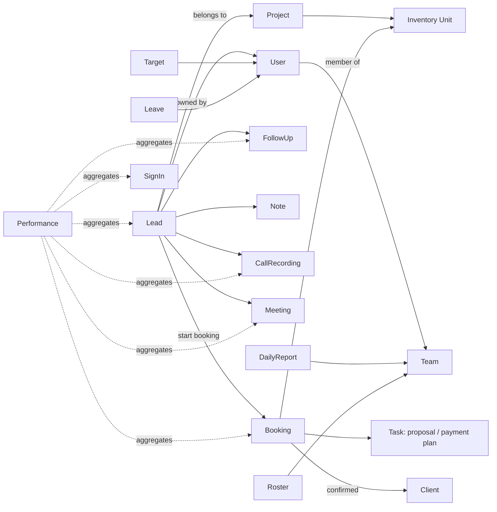

# Modules and Features

Labels: **OBSERVED** · **INFERRED** · **PROPOSED** · **UNKNOWN** (see `REVERSE_ENGINEERING_REPORT.md`).
Part A describes the reference CRM's functionality. Part B describes the **additional Accounts & Finance module**, which does **not** exist in the reference CRM.

---

# Part A — Reference Functionality

## Cross-cutting patterns (OBSERVED)

- **Project scope.** A global project selector in the header filters most modules.
- **List pages.** Each has a title and description, KPI tiles (for example "Total", "Active filters", "On this page"), a **Filters** side panel ("changes apply immediately", with Clear filters and Done buttons), sortable column headers (▲▼), and pagination (Page X of Y, a page number box with Go, Previous / Next).
- **Detail pages.** Each has a "← Back" link, a header summary and tabbed sections.
- **Access control.** Restricted sections show a "RESTRICTED · Access denied · Ask an admin" card.
- **Notifications.** A bell with an unread count, plus pop-up alerts such as "FOLLOW-UP SOON · <lead> · <time> · VIEW / ALL".

---

## 1. Dashboard — `/dashboard`

**Purpose:** a live overview of the sales pipeline for the selected project and the user's scope.

| Widget | Content | Label |
|---|---|---|
| Header | "Analytics Dashboard", signed-in user, role badge, "Live Workspace Stream" | OBSERVED |
| Executive essentials | Total leads (open / won / lost %), Conversion rate (win on decided), Open pipeline, Won / Lost with attrition %, Regenerated (re-inquiries, awaiting first touch) | OBSERVED |
| Team filter | "HOD Sales / All teams" and range chips: 24h, 7d, 30d, MTD, 6m, Custom | OBSERVED |
| Organization health | Active projects; top projects by lead volume | OBSERVED |
| Pipeline health — Aging vs Meetings | Matrix of lead age buckets (0–1M … 12M+) × meeting-count buckets, with leads, meetings and average per owner; stale = no update in 14 days | OBSERVED |
| Stale pipeline / No meeting / Meetings done | KPI tiles | OBSERVED |
| Lead sources | Volume and share by acquisition source | OBSERVED |
| Inbound channels | Manual / Meta / TikTok distribution | OBSERVED |
| Recent leads | Latest 20: name, status, inbound, owner, created | OBSERVED |
| Lost leads by reason | Count by reason; click a reason to open those leads | OBSERVED |
| Lost leads by team | Click a team to see its agents | OBSERVED |
| Snapshot time | "Snapshot: hh:mm" | OBSERVED |

**Links:** KPI tiles link to Leads, Won, Regenerated and Reports.

---

## 2. Leads — `/dashboard/leads/*`

**Purpose:** capture, assign, work and track prospective buyers through the sales pipeline.

### 2.1 Sub-views (OBSERVED)

| View | Route | Behaviour |
|---|---|---|
| All | `/leads` | Full table with search, Filters, Clear, **Add lead** |
| To-dos | `/leads/todos` | Queues: follow-ups Today and Done today; Upcoming Tomorrow / 7 / 15 / 30 days; Overdue leads, tasks and meetings; Unattended new leads 24h+. Refresh button |
| Shared phones | `/leads/phone-overlap` | Groups of non-duplicate leads sharing country code + phone; "merge or reassign as needed" |
| Pipeline | `/leads/pipeline` | **Board** (Kanban \| Table) and **Analytics** tabs; stage counts |
| Regenerated | `/leads/regenerated` | Leads that enquired again; ones not yet worked are listed first |
| Favorites | `/leads/favorites` | Personal starred shortlist |
| Reviews | `/leads/reviews` | Manager reviews on the user's leads |
| Won | `/leads/won` | Booked opportunities |
| Lost | `/leads/lost` | Lost leads and lost-reason mix; "Managers and admins can approve team lost requests from Approvals" |
| Duplicates | `/leads/duplicates` | Flagged duplicates and their originals |

### 2.2 Lead fields

| Field | Notes | Label |
|---|---|---|
| Lead code | 8-character uppercase code | OBSERVED |
| Name | | OBSERVED |
| Phone + country code | Shown with "+92" selector; formats like `3001234567` | OBSERVED |
| Email | Optional | OBSERVED |
| City | Free text (dirty data seen) | OBSERVED |
| Stage | 10 values (see 2.3) | OBSERVED |
| Time in stage | e.g. "38d 18h" | OBSERVED |
| Agent / owner | Assigned user | OBSERVED |
| Created / Modified | Timestamps | OBSERVED |
| First touch | Time from creation to first interaction | OBSERVED |
| Next follow-up | Date-time | OBSERVED |
| Source | 15 values (see 2.4) | OBSERVED |
| Inbound channel | Manual / Meta / TikTok | OBSERVED |
| Budget | Range, e.g. "Under PKR 10 million" | OBSERVED |
| Project | Linked project | OBSERVED |
| Priority | Not selected / Low / Medium / High | OBSERVED |
| Size | e.g. "674 sq ft" (desired size) | OBSERVED |
| Gender | Free text ("e.g. male, female") | OBSERVED |
| Comment | Latest note or raw intake payload | OBSERVED |
| External ID | "Ext …" (ad-platform lead ID) | OBSERVED |
| Flags | Regenerated, Duplicate, Favorite (★) | OBSERVED |
| Lost reason | Required for the lost reasons report | INFERRED |

### 2.3 Pipeline stages (OBSERVED)

`New Lead → Contact Attempted → Contacted → Qualified Lead → Meeting Scheduled → Meeting Done → Booking in Process → Booked`, plus `Lost Lead` and `Future Opportunity`.

### 2.4 Lead sources (OBSERVED)

WhatsApp, Email, Website, Twitter, TikTok, Billboard, Walk in, Personal, Reference, Cold data, Dealers, Facebook, Google, Old CRM (Meta), CEO data.

### 2.5 Filters (OBSERVED, Pipeline)

Stage (multi-select) · Follow-up (Overdue / Within 1 day / Within 2 days / After 2 days) · Source (multi) · Priority (multi) · City (multi) · Date field (Created / Updated) with Day or From–To dates · Search by name, email, phone, lead code or ID.

### 2.6 Lead detail page (OBSERVED in pass 1)

- **Header:** name, owner, project, external ID, Back to list.
- **Facts:** code, phone, stage, inbound channel, first added, first interaction ("earliest note, file, activity, follow-up, meeting or booking"), time to first touch.
- **Booking card:** "Start booking →" on this project.
- **AI Intelligence:** call recordings with their analysis status (Not analysed / analysed), "View AI details" and Refetch.
- **Timeline:** recent five interactions plus "Full timeline". Event types seen: Note, Follow-up scheduled (with due date), Stage change (from → to), File (call recording), Auto-assigned (rotation).
- **Tabs:** Profile · Follow-ups · Assets & History · Upload Documents · Timeline. Only the tab names were seen for Follow-ups, Assets & History and Upload Documents; their contents are UNKNOWN.
- **Edit sections:** Pipeline stage ("Select target stage…"), Contact (country code, mobile), Profile (gender, size), Interest & pipeline (source, project, budget), Location (city), Notes ("Call outcome, next step, objection…"), Add note, Save changes / Cancel.

### 2.7 Actions

| Action | Label |
|---|---|
| Add lead manually | OBSERVED (button); form fields UNKNOWN |
| Change stage | OBSERVED |
| Add note / schedule follow-up / mark follow-up done ("ADD" / "DONE" in table) | OBSERVED |
| Upload call recording / documents | OBSERVED |
| Star as favourite | OBSERVED |
| Start booking from lead | OBSERVED |
| Request lost → manager approval | OBSERVED (text) |
| Merge or reassign shared-phone leads | OBSERVED (text) |
| Auto-assignment by rotation | OBSERVED (timeline) |
| Meta / TikTok lead ingestion | OBSERVED (results) |
| Bulk import / export | UNKNOWN |

---

## 3. Clients — `/dashboard/clients`

**Purpose:** long-term profiles of buyers ("profiles, investments, contracts, and payment history"). OBSERVED [page subtitle]

| Element | Detail | Label |
|---|---|---|
| Columns | Client, Contact, Relationship, Latest investment, Next follow-up, Updated | OBSERVED |
| Filters | Search; "Has investment in project" | OBSERVED |
| Records | 0 visible to this role | OBSERVED |
| Client detail page | Not reachable (no records) | UNKNOWN |
| Lead → client conversion rule | Probably created when a booking is confirmed | INFERRED |

---

## 4. Projects — `/dashboard/projects`

**Purpose:** portfolio of buildings, farmhouses and societies; "Define inventory dimensions and units per project". OBSERVED

| Element | Detail | Label |
|---|---|---|
| KPI | Projects, Units tracked, Project types | OBSERVED |
| Card | Name, type badge (BUILDING), status (INACTIVE badge), company label (e.g. developer name), units tracked, Open → | OBSERVED |
| Company label meaning | Developer / owner company | INFERRED |
| Detail | "Inventory dimensions (premium, floors, block, size, category, type, …) are defined per project", View inventory | OBSERVED (text); body Access denied |
| Create / edit project | Admin only | INFERRED |

---

## 5. Inventory — `/dashboard/inventory`

**Purpose:** units for sale per project, aligned with bookings.

| Element | Detail | Label |
|---|---|---|
| Columns | #, Project, Floor, Unit, Sale model, Area, Base price, Nature, Category, Status, Sales, Type, Bed, Comment, Date | OBSERVED |
| Statuses | Available, Partially booked, Reserved, Booked, Sold | OBSERVED |
| Sale models | Whole unit, SPU strips, 50% fractional | OBSERVED |
| Nature | Apartment (only value present) | OBSERVED |
| Filters | Search, Project, Status, Nature, Sale model | OBSERVED |
| SPU split | Units split into 50 sq ft "SPU" shares; bookings can target a share | INFERRED (import notes) |
| Price plan notes | "Down 30%; 36 mo" installments in import comments | INFERRED |
| Unit detail | "Open a unit for full dimensions and details" | OBSERVED (text); page UNKNOWN |
| CSV import | Import notes on units; no import button for this role | INFERRED |

---

## 6. Bookings — `/dashboard/bookings`

**Purpose:** "Lead → negotiation → forms & payments → confirmed. Units stay aligned with inventory." OBSERVED

| Element | Detail | Label |
|---|---|---|
| Columns | Lead, Sales agent, Unit, Project, Stage, Paid, Updated, Open | OBSERVED |
| Stages | Negotiation, Token pending, Token received, Provisional receipt, Sales order, Booking form, Down payment, Agreement pending, Confirmed, Cancelled | OBSERVED |
| Filters | Search, Project, Stage | OBSERVED |
| New booking | Project*, Lead*, Unit (available)*, Per sq ft rate (PKR)*, Token amount (PKR)*, Payment instructions for buyer; "Create booking" | OBSERVED |
| Hold rule | The token amount decides how long the unit stays held; unpaid holds are released automatically on expiry | OBSERVED (text) |
| Side effect | Creating a booking moves the lead to "Booking in Process" | OBSERVED (text) |
| Detail tabs | Overview · Provisional receipt · Sales order | OBSERVED (names) |
| Overview fields | Payment instructions (shown to buyer), Sales agent, Reserved until, Total sale (PKR), 30% milestone (Met / Not met), Agreement sent, Payment docs (Not submitted / …), Paid X / Total | OBSERVED |
| Provisional receipt / Sales order contents | Not loaded | UNKNOWN |
| Hold-duration formula | Token → days | UNKNOWN |

---

## 7. Tasks — `/dashboard/tasks`

**Purpose:** "Create, assign, and track CRM tasks including printable plans." OBSERVED

| Element | Detail | Label |
|---|---|---|
| Columns | Title, Type, Status, Due, Assignee, Updated, Actions | OBSERVED |
| Types | General, Payment plan printable, Proposal | OBSERVED |
| Statuses | Open, In progress, Done, Cancelled | OBSERVED |
| Filters | Status, Type, Assignee | OBSERVED |
| Create form | Title, Type, Due, Assignee, Lead, Booking, Description | OBSERVED |
| Proposal template | Cover page (customer name*, prepared date, prepared by name/title); Project & client (project search, print title, client name, custom header); Unit (inventory search auto-fills area, apartment no, list price; price per sq ft; total sale value = area × price/sq ft); Discount & payments (after discount, down payment, each installment, count default 36); Installment rows (#, installment, description, progress, amount) + "Rebuild installment rows" | OBSERVED |
| Printed sections | Exclusive Investment Proposal; Project Overview; Investment Summary; Exclusive Bonuses & Incentives; Why Act Now; Next Steps | OBSERVED |
| Business rules | Agents may discount up to 5% (app setting); ROI per year uses a per-sq-ft ROI setting; a default price/sq ft is used when a unit has no list price | OBSERVED (help text) |

---

## 8. Meetings — `/dashboard/meetings`

| Element | Detail | Label |
|---|---|---|
| Purpose | "Schedule, filter, and manage team meetings." | OBSERVED |
| Columns | Title, When, Organizer, Lead, Status, Updated, Actions | OBSERVED |
| Statuses | Scheduled, Completed, Cancelled | OBSERVED |
| Filters | Search, Status, Organizer | OBSERVED |
| Metrics use | Meetings feed the dashboard (meetings done) and Performance | OBSERVED |
| Create form | No create button seen for this role; probably scheduled from a lead | INFERRED |
| Participants / location / reminders | Not seen | UNKNOWN |

---

## 9. Targets — `/dashboard/targets`

| Element | Detail | Label |
|---|---|---|
| Purpose | "Goals set for your user for the selected period" | OBSERVED |
| Period | Daily / Weekly / Monthly; anchor date; period start shown in UTC | OBSERVED |
| Columns | Agent, Calls, Meetings, Sold sq ft, Actions | OBSERVED |
| Who sets targets | Managers / admins (Actions empty for agent) | INFERRED |
| Achievement vs target view | Not seen | UNKNOWN |

---

## 10. Teams — `/dashboard/teams`

| Element | Detail | Label |
|---|---|---|
| Purpose | "Manage sales teams, members, performance, and manager daily reports." | OBSERVED |
| KPIs | Teams, Active (assignable), Inactive (hidden from assignment), Members | OBSERVED |
| Tab: Teams | Team list + members panel | OBSERVED (layout); Access denied |
| Tab: Daily Report | Manager enters per-agent Leads, Calls, Meetings, Tokens, Bookings, Remarks for a team and date; admins review date-wise submissions (admins see all teams, managers their own) | OBSERVED |
| Tab: Duty Roster | Day / Month calendar; per member In office / On site / On leave / Leads off; "Save roster"; leads-off days excluded from Avg M / Avg QC | OBSERVED |

---

## 11. My Workplace — `/dashboard/workspace`

| Element | Detail | Label |
|---|---|---|
| KPIs | Upcoming holidays, Leave requests this year, Sign-ins logged | OBSERVED |
| Upcoming holidays | Company-wide and organization dates from HR | OBSERVED |
| My leave | Own requests with status and dates, by year | OBSERVED |
| CRM sign-in log | Signed in / out, timestamp, IP address | OBSERVED |

---

## 12. HR — `/dashboard/hr`

| Element | Detail | Label |
|---|---|---|
| Purpose | "Employee records, holiday calendar, leave requests, and activity. Payroll is managed under Finance." | OBSERVED |
| Employees | "Roles, departments, contacts, and profiles" | OBSERVED (card); page Access denied |
| Holidays | "Company-wide and regional holidays" | OBSERVED (card); page Access denied |
| Leave | Annual allowed (30 days/year), used, remaining; New request: type (Annual / CPL), start, end (inclusive), reason; Requests table: employee, type, dates, status; approvals | OBSERVED |
| Attendance | CRM sign-ins only (no clock-in seen) | INFERRED |
| Payroll | Referenced, not seen | UNKNOWN |

---

## 13. Performance — `/dashboard/performance`

| Element | Detail | Label |
|---|---|---|
| Purpose | "Agent KPIs and CRM attendance for your scope (same metrics as team reports)" | OBSERVED |
| KPIs | Agents, Open leads, Booked, Lost, Calls, Meetings, CRM sign-ins, Team win %, Follow-up % (done of due), Avg calls/agent (total + minutes), Avg meetings/agent, Meaningful call %, Pipeline pressure | OBSERVED |
| Charts | Outcome mix; Call quality (Verified ≥30 s, Qualified ≥60 s); Top closers; Call volume leaders; Calls vs meetings | OBSERVED |
| Table | Agent, Open leads, Booked, Lost, Win %, Calls, Call min, F/U due, F/U done, F/U %, Meetings, CRM sign-ins, CRM sign-outs; "Critical" flag; "Critical only" filter | OBSERVED |
| Critical-flag rule | Thresholds not shown | UNKNOWN |

---

## Module relationships (reference)

---

# Part B — Additional Module: Accounts & Finance (PROPOSED)

> **Not present in the reference CRM.** Requested by the client as an additional module. All items below are **PROPOSED** and need business confirmation.

| Feature | Proposed scope (V1, basic) |
|---|---|
| Income records | Manual income entries: date, category, amount (PKR), method, reference, linked project / booking (optional), attachment |
| Expense records | Manual expense entries: date, category, vendor / payee, amount, method, reference, project (optional), attachment |
| Booking payments | Record payments received against a booking (token, down payment, installments) |
| Outstanding balances | Per booking: total sale − payments received; due vs overdue against the installment schedule |
| Payment history | Chronological payments per booking / client, with receipt number |
| Financial reports | Income vs expense by period; collections by project; outstanding by project / agent; export to CSV / PDF |

### Business rules to confirm before implementation

1. Do booking payments in Finance replace the reference "Paid" figure on bookings, or sit alongside it?
2. Who can record or approve payments (accountant, admin, sales manager)?
3. Is a payment editable after entry, or only reversible by a reversal entry (audit)?
4. Receipt numbering format, and whether the provisional receipt document is generated from Finance.
5. Is the installment schedule from the Task proposal binding for computing "overdue"?
6. Fixed income and expense category lists?
7. Multi-currency (e.g. overseas buyers paying in SAR or AED)? PROPOSED V1: PKR only.
8. Is payroll in scope? (HR says payroll is under Finance.) PROPOSED: **out of scope** unless quoted separately.
9. Tax, bank integration, payment gateway, double-entry ledger: **out of scope** (as stated in the quotation).
