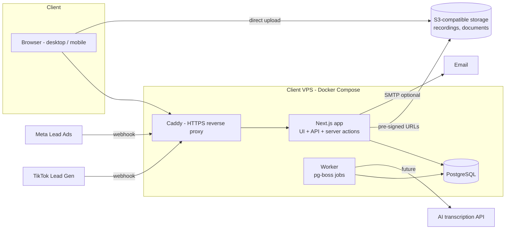

# System Architecture (PROPOSED)

> This describes **our** planned system. It makes no claim about how SaleStorm is built internally.

## 1. Architectural drivers

| Driver | Source | Implication |
|---|---|---|
| ≤ 10 users, ~3k leads, ~150 units / project | Quotation; observed volumes | A single server and database is plenty. No microservices. |
| PKR 175k fixed budget, very short V1 window | Quotation | Use one language end to end, proven libraries, little infrastructure. |
| Client owns code; no maintenance included | Quotation | Mainstream stack that local developers can maintain; clear docs; few paid services. |
| Background jobs: hold expiry, rotation, reminders, webhooks | Bookings, Leads | A reliable job queue is needed, preferably without an extra server. |
| File uploads: call recordings, documents | Leads, Bookings | Object storage with size and type limits. |
| Printable documents: proposal, receipt, sales order | Tasks, Bookings | HTML print templates to PDF. |
| Role and team-scoped data | Permissions | A central authorization layer enforced on the server. |
| Integrations: Meta, TikTok (and AI later) | Leads | Webhook endpoints with signature checks; client-paid API accounts. |
| Financial records | Finance module | Immutable payment entries, audit log, backups. |

## 2. Recommended stack

| Layer | Choice | Why | Alternatives considered |
|---|---|---|---|
| Language | **TypeScript** (front + back) | One language, type safety across API and UI, fewer bugs at speed | PHP / Laravel (popular locally, but a separate frontend effort) |
| Web framework | **Next.js (App Router)**, server actions + route handlers | UI and API in one deployable, server-side rendering, large talent pool | Remix; Laravel + Inertia; NestJS + React SPA (more moving parts) |
| UI | **Tailwind CSS + shadcn/ui (Radix)** | Matches the reference look; accessible primitives; fast to build | MUI (heavier; harder to match the style) |
| Tables / forms | TanStack Table, React Hook Form + Zod | Server-side pagination, shared validation schemas | — |
| Database | **PostgreSQL 16** | Relational data, transactions for bookings and payments, JSONB for raw lead payloads | MySQL (fine; Postgres has better JSONB and constraints) |
| ORM / migrations | **Prisma** (or Drizzle) | Typed queries, migration history the client keeps | Raw SQL |
| Auth | **Auth.js (credentials)** or a small custom session module; Argon2id password hashing; DB-backed sessions | No vendor lock-in or per-user fees; sign-in / out logging needed anyway | Clerk / Auth0 (monthly cost, vendor dependency) |
| Authorization | In-app policy module (role → permissions + record scope) | Simple matrix; testable | Casbin / CASL (overkill for 6 roles) |
| Background jobs | **pg-boss** (queue inside Postgres) + a worker process | No Redis to run; durable scheduled jobs | BullMQ + Redis |
| File storage | **S3-compatible** (Cloudflare R2 / DigitalOcean Spaces) via pre-signed URLs; local disk only in dev | Cheap, scalable, keeps the app server stateless | VPS disk (simpler, but backups are harder) |
| PDF / print | HTML print CSS (browser print); server PDF via Playwright later if needed | Quick; templates are editable | React-PDF |
| Notifications | DB `notifications` table + polling every 30–60 s (SSE later) | Enough for 10 users | WebSockets (unnecessary complexity) |
| Email (optional) | SMTP / Resend (client-paid) | Password reset, approvals | — |
| Charts | Recharts | Lightweight | Chart.js |
| Logging | Structured JSON logs (pino); optional Sentry free tier | Debuggable after handover | — |
| Hosting | **One VPS** (2 vCPU / 4 GB) with Docker Compose: app, worker, Postgres, Caddy (TLS) | Predictable low cost (client-paid), data stays under client control | Vercel + Neon + R2 (zero-ops, but several vendors and usage-based bills) |

## 3. High-level architecture



## 4. Code organisation (modular monolith)

```text
src/
  app/                 # Next.js routes (UI pages + /api route handlers)
  modules/
    auth/  users/  teams/  leads/  clients/  projects/  inventory/
    bookings/  tasks/  meetings/  targets/  hr/  performance/
    finance/  notifications/  settings/  audit/  integrations/
      <module>/
        schema.ts      # Zod validation
        service.ts     # business rules (pure, testable)
        repo.ts        # DB access
        policy.ts      # permission checks
        jobs.ts        # background jobs (if any)
  lib/                 # db client, auth, storage, logger, pdf
  components/          # shared UI (DataTable, FilterDrawer, StatusBadge, ...)
prisma/                # schema + migrations
```

Rules: UI → server action / route → **policy check** → service → repo. Business rules live in the services only, never in UI components.

## 5. Key technical designs

| Concern | Design |
|---|---|
| Lead rotation | A `rotation_state` row per team/project; transaction picks the next eligible agent (active, not on leave, not "leads off" today) with `SELECT … FOR UPDATE`. |
| Duplicates / regenerated | Normalised phone (E.164) unique index per project for open leads. On a match, apply the business rule (Q-L1). |
| Unit hold | On booking creation, compute `hold_expires_at`. A pg-boss job is scheduled for that time; if the token is not received, release the unit and cancel the booking. All of it runs in one DB transaction with row locks to prevent double-booking. |
| Stage machines | Lead and booking transitions are defined as allowed-transition maps in the service; every change writes a `*_stage_history` row. |
| Metrics | Performance and dashboard computed with SQL aggregates over indexed tables; optional nightly materialised views if slow. |
| Time | Store UTC; display Asia/Karachi; target periods anchored to the local date (the reference shows UTC; PROPOSED: local). |
| Files | Upload via pre-signed PUT, max size by type (audio 25 MB, docs 10 MB), MIME allow-list, private bucket, signed GET links (short expiry). |
| Printing | Server-rendered print routes (`/print/proposal/:id`) with A4 CSS. |
| Integrations | `/api/webhooks/meta`, `/api/webhooks/tiktok` verify signatures and enqueue jobs, which create leads asynchronously; raw payloads are stored. |
| Migration | One-off import scripts for the reference CRM's CSV exports (leads, units), if the client can export them. |

## 6. Environments and deployment

| Env | Purpose |
|---|---|
| Local | Docker Postgres, dev server |
| Staging | Same VPS (separate compose project / DB) or a cheap second VPS; for client demo (10 Nov) |
| Production | Client's VPS + domain + TLS |

Pipeline: GitHub repo (client-owned at handover) → CI (lint, typecheck, tests) → build Docker image → deploy over SSH (`docker compose pull && up -d`) → run migrations.

## 7. Trade-offs and risks

- **Next.js full-stack vs separate API.** Faster to build and deploy; the API is less reusable for a future mobile app. Mitigation: keep services framework-agnostic and expose REST route handlers for key resources (see `API_DESIGN.md`).
- **pg-boss vs Redis queue.** Lower throughput, which is irrelevant at this scale, and one fewer service.
- **VPS vs serverless.** The client or someone must apply OS updates and watch backups. Maintenance is not included in the quote, so this must be agreed (Q-T3).
- **AI call analysis and Meta / TikTok** depend on third-party accounts, app review and per-use fees, all client-paid. They are the biggest schedule risk among the integrations.
