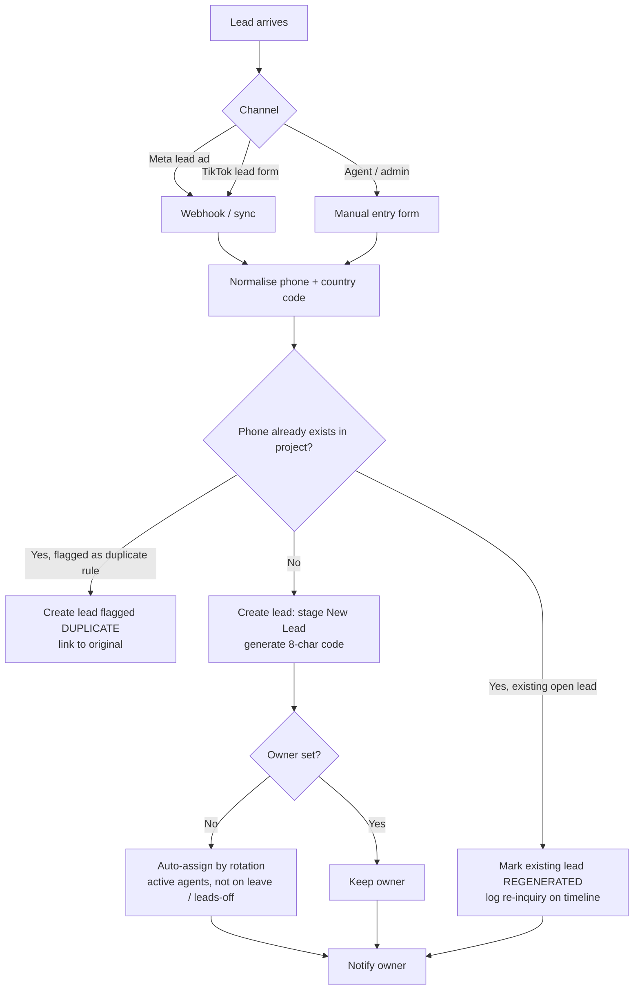
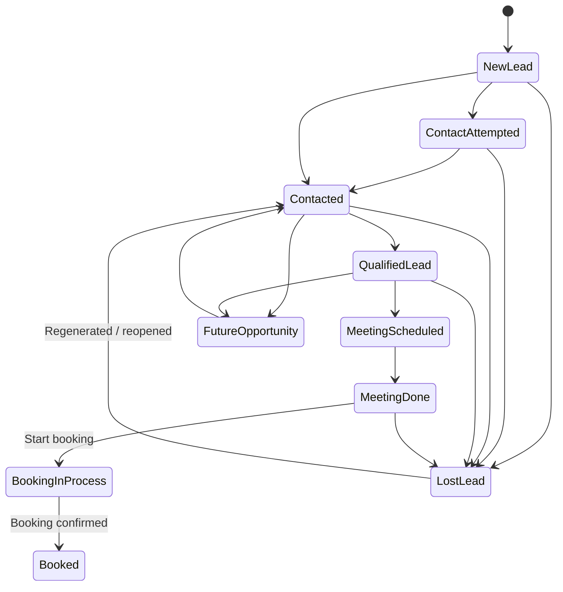
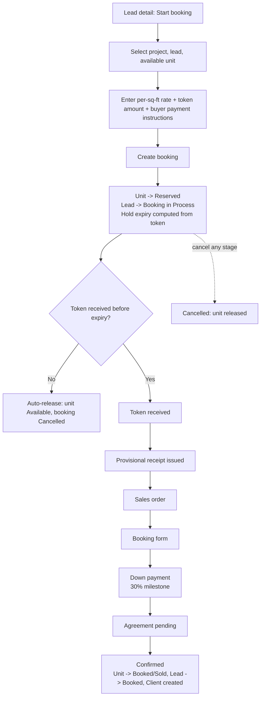
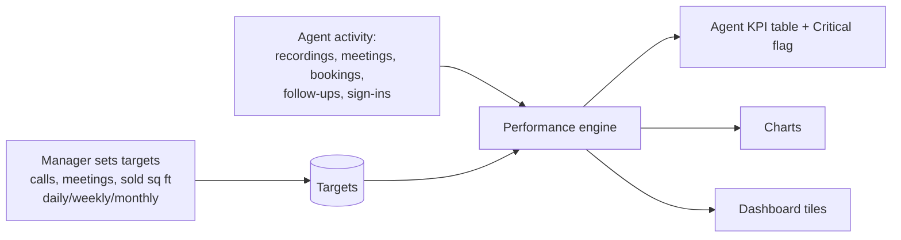
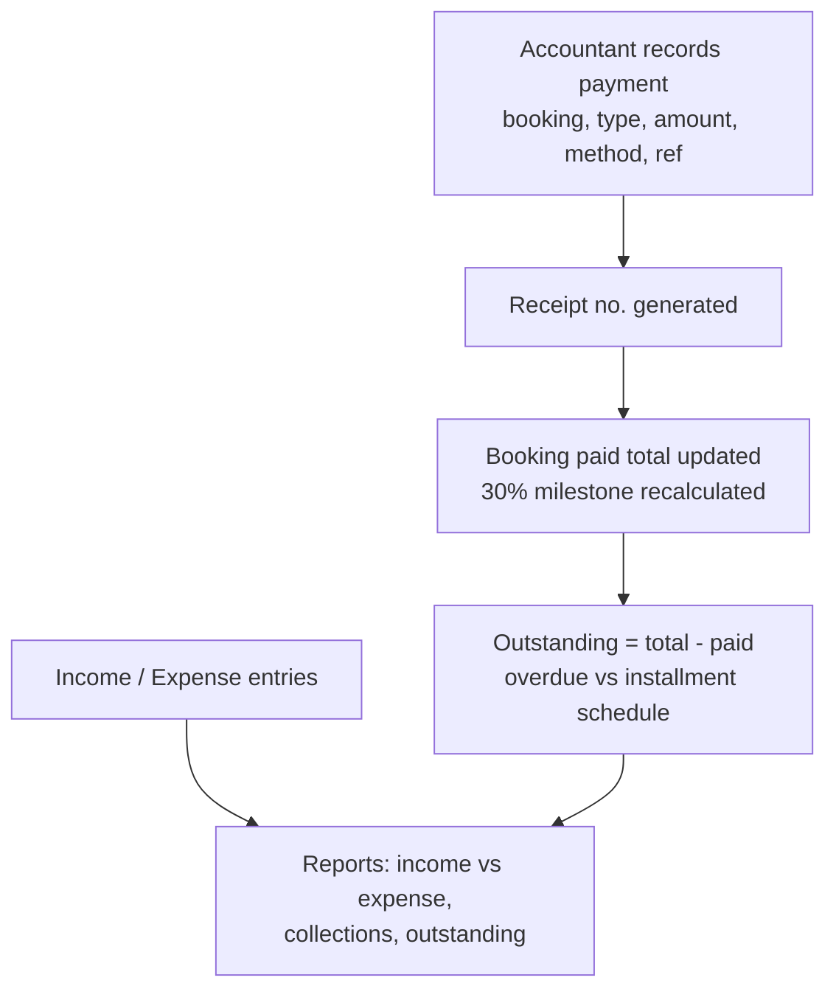

# User Flows

Each flow is marked **OBSERVED** (seen in the reference CRM), **INFERRED** or **PROPOSED** (new CRM design).

---

## 1. Lead intake and assignment

**Basis:** OBSERVED (Manual / Meta / TikTok channels, rotation, duplicates, regenerated). The duplicate / regenerated decision logic is INFERRED.



> PROPOSED: the exact rule for "regenerated vs duplicate" must be confirmed (Q-L1).

## 2. Working a lead: pipeline and follow-ups

**Basis:** OBSERVED (stages, follow-ups, notes, recordings, To-dos).



> Transitions shown are INFERRED. The reference allows choosing any "target stage". PROPOSED V1: allow any forward move; backward moves and Lost need a reason.

**Daily agent loop (OBSERVED):**
1. Open **To-dos**: today's follow-ups, overdue items, unattended new leads.
2. Call the lead, then upload the recording (optional) and add a note: outcome, next step, objection.
3. Change the stage if needed.
4. Schedule the next follow-up (date-time).
5. Mark the previous follow-up **Done**.

## 3. Mark lead lost (with approval)

**Basis:** OBSERVED (text: "approve team lost requests from Approvals"). The steps below are INFERRED.

```mermaid
sequenceDiagram
  participant Ag as Agent
  participant S as System
  participant M as Manager
  Ag->>S: Request "Lost" + reason
  S->>M: Approval item + notification
  alt Approve
    M->>S: Approve
    S->>S: Stage = Lost Lead, reason saved
  else Reject
    M->>S: Reject (comment)
    S->>Ag: Notify; lead stays in previous stage
  end
```

## 4. Project and inventory setup

**Basis:** OBSERVED (projects, dimensions text, unit fields); the admin steps are INFERRED.

1. Admin creates a project: name, type, developer, status.
2. Admin defines inventory dimensions: floors, block, category, type, premium.
3. Admin adds units manually or imports a CSV: floor, unit no., area, base price, sale model, beds.
4. Units start as **Available**.
5. SPU units are split into shares (e.g. 50 sq ft strips) (INFERRED).

## 5. Booking

**Basis:** OBSERVED (form fields, stages, hold rule, overview fields). The stage gate rules are PROPOSED.



## 6. Proposal and payment plan (Tasks)

**Basis:** OBSERVED.

1. Create a task of type **Proposal** or **Payment plan printable**, linked to a lead and / or booking.
2. Pick the project and unit; area and list price fill in automatically.
3. Enter a discount (agent cap 5%), down payment % and number of installments (default 36).
4. The installment rows are generated, and can be edited or rebuilt.
5. Print the proposal: cover page, project overview, investment summary, bonuses, why act now, next steps.

## 7. Meetings

**Basis:** OBSERVED (list, statuses); creation from a lead is INFERRED.

`Schedule (title, date-time, lead)` → `Scheduled` → `Completed` (lead → Meeting Done, PROPOSED prompt) or `Cancelled`. Overdue meetings appear in To-dos.

## 8. Targets and performance

**Basis:** OBSERVED (targets, KPIs). Achievement tracking is PROPOSED.



## 9. Team management

**Basis:** OBSERVED.
- **Daily report:** the manager picks a team and a date, enters per-agent leads, calls, meetings, tokens, bookings and remarks, and submits. Admins review the submissions by date.
- **Duty roster:** the manager picks a team and a day or month view, sets In office / On site / On leave / Leads off for each member, and saves the roster.

## 10. Leave

**Basis:** OBSERVED (request form and table); the approval flow is INFERRED.

`Employee: New request (Annual/CPL, start, end, reason)` → `Pending` → Manager / HR `Approve` (balance reduced) or `Reject`. The result is visible in My Workplace.

## 11. Accounts & Finance (PROPOSED, additional module)


